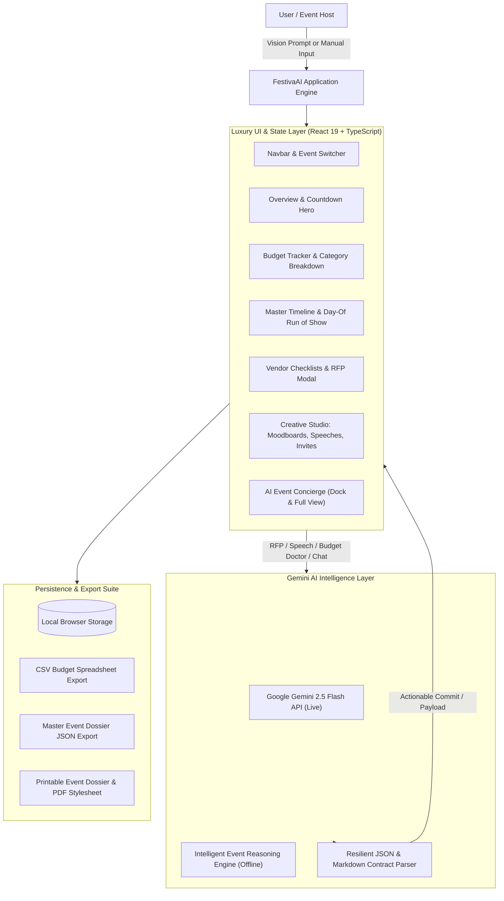

# FestivaAI — Autonomous GenAI Celebration & Event Planner
## Official Submission Documentation & Evaluation Dossier
**Challenge 05:** Celebration & Event Planner  
**Platform:** Bi-Weekly Vibe Coding Challenge  
**Author:** Pair-Programmed with Google Antigravity IDE & Gemini AI  

---

## 1. Tool Usage Enforcement & Rationale

| Tool / Technology | Role in Project | Why Selected? |
| :--- | :--- | :--- |
| **Google Antigravity IDE** | Autonomous Pair Programming & Agentic Workflow | Provides deterministic file editing, multi-file orchestration, background execution, and integrated browser subagents for visual validation. |
| **Google Gemini API (`gemini-2.5-flash`)** | Core Reasoning & Generative Intelligence | Lightning-fast inference (sub-second latency), structured JSON contract enforcement, and multimodal creativity for theme generation, budget optimization, and copycrafting. |
| **Vite 8 + React 19 + TypeScript** | Frontend Architecture & Fast Dev Server | Instant Hot Module Replacement (HMR), strict type safety via `verbatimModuleSyntax`, zero runtime overhead, and bundle efficiency (725ms production build). |
| **Canvas Confetti** | Celebration Feedback Engine | Provides celebratory visual delight upon completing milestones, saving budget, or hitting planning countdowns. |
| **Lucide React** | Design System Iconography | Crisp, accessible, consistent vector icons for event logistics, categories, and actions. |
| **Vitest** | Automated Verification & Testing Suite | Blazing fast in-memory execution (336ms run time) ensuring financial math, timeline ordering, and JSON parsing integrity. |

---

## 2. Human vs. GenAI Division of Labor

### What GenAI Handled:
1. **Dynamic Event Blueprint Synthesis:** Given a free-form vision prompt (e.g., *"Italian destination 40th birthday in Tuscany for 40 guests with $15,000 budget"*), Gemini autonomously generates a complete event model comprising:
   - Budget categories & line items with market-rate financial estimates.
   - Multi-phase preparation roadmap + hour-by-hour **Day-Of Run of Show** execution cues.
   - Realistic vendor profiles with custom vetting checklists and inquiry guidelines.
   - Tailored theme concepts with hex color palette swatches, signature cocktails, and guest activities.
2. **AI Budget Doctor:** Analyzes expense ratios, identifies overspending categories, and generates 4 tailored savings tactics with projected monetary savings.
3. **AI Vendor RFP & Negotiation Drafter:** Generates custom inquiries for WhatsApp and formal Email, pre-filling event logistics and custom questions.
4. **Speech & Toast Crafter:** Writes bespoke speeches (Best Man, Maid of Honor, Parents, Hosts) tailored by tone (Humorous, Emotional, Formal, Poetic).
5. **Interactive Copilot (Concierge):** Multi-turn conversational planning assistant with 1-click **"Apply to Event"** actionable payloads.

### What Human Designed:
1. **System Architecture & Data Contracts:** Defined strict TypeScript interfaces (`EventModel`, `BudgetItem`, `TimelineMilestone`, `Vendor`, `PersonalizedIdea`) ensuring consistent data flow.
2. **Financial Math & Invariant Protection:** Created deterministic budget calculations (projected cost, paid to date, remaining capacity, contingency protection) avoiding floating-point or hallucination errors.
3. **Luxury Design System & Aesthetics:** Designed a custom celebration palette (deep obsidian, champagne gold, royal violet, emerald success) with responsive glassmorphism, accessible contrast ratios, and printable dossier layouts.
4. **Resilient Offline Architecture:** Built an intelligent local fallback reasoning engine so the entire app operates at full fidelity even without a network connection or API key.
5. **Client-Side Privacy:** Guaranteed zero-storage of user Gemini API keys on external servers by maintaining storage strictly inside the local browser (`localStorage`).

---

## 3. How Prompts Evolved

The prompt engineering strategy underwent 3 distinct iterations:

```
[Iteration 1: Naive Freeform]
"Plan a wedding budget and timeline for 100 people"
  ↳ Issue: Unstructured text, inconsistent categories, unparseable into interactive UI components.

[Iteration 2: Schema Constrained]
"Plan a wedding with budget items and milestones. Output JSON."
  ↳ Issue: Occasional hallucinations of non-numeric budgets, missing time slots for Day-Of schedules, and markdown fence wrapping errors.

[Iteration 3: Production Contract with Resilient Parser (Current)]
"You are FestivaAI, an elite event planner and celebration architect...
Output strictly valid JSON matching schema: { title, theme, totalBudget, budgetItems: [{id, category, estimatedCost, actualCost}], timeline: [{phase, isDayOf, timeSlot}] }..."
  ↳ Result: Deterministic, type-safe JSON extraction with regex fallback and markdown codeblock stripping. Real-time 1-click UI commits.
```

---

## 4. Architecture & Prompt Flow Diagram



---

## 5. Problem Statement Alignment

| Challenge Requirement | FestivaAI Implementation |
| :--- | :--- |
| **Weddings** | The Royal Heritage Wedding & Sangeet (Udaipur): Palace venue, global fusion catering, pheras & baraat timeline, bridal lehenga attire, ittar favors, Best Man / Father of the Bride toasts. |
| **Milestone Birthdays** | Neon Horizon 30th Birthday Bash: Rooftop penthouse venue, molecular cocktail mixology, retro arcade & 360 photo booth, humorous roast & toast speech, cyberpunk WhatsApp invite. |
| **Community Events** | Unity in Bloom Cultural Fair & Charity Gala: Park permits, volunteer coordination, food truck vetting, acoustic amphitheater schedule, raffle & unity mural activities. |
| **Interactive Budgets** | Real-time budget meter, category breakdown bar chart, currency switcher (USD, INR, EUR, GBP, CAD, AUD), paid/pending ledger, and **AI Budget Doctor** cost-saving recommendations. |
| **Timelines** | Dual-mode: Phased countdown milestones (6mo, 3mo, 1mo, 1wk) + hour-by-hour **Day-Of Run of Show** execution matrix with confetti completion feedback. |
| **Vendor Checklists** | Category vetting directory (Venue, Catering, Photography, DJ, Decor), interactive checklists, quote tracking, and **GenAI RFP / Message Generator** for WhatsApp & Email. |
| **Personalized Ideas** | Creative Studio with visual theme moodboards, hex color swatches, AI Speech & Toast Crafter, and AI Invitation & RSVP copywriter. |

---

## 6. Ready-to-Publish LinkedIn Submission Post

```text
🚀 Excited to unveil FestivaAI — an Autonomous GenAI Celebration & Event Planner built for Challenge 05 of the Vibe Coding Challenge! 🎉💒🎂

Organizing major milestones — whether a 250-guest destination wedding, a cyberpunk 30th rooftop bash, or a 500-person community cultural fair — is notoriously stressful. Budgets blow out, vendors drop the ball, and day-of schedules spiral.

I built FestivaAI as an elite GenAI planning assistant paired with Google Gemini and Google Antigravity:

✨ What FestivaAI Delivers:
• 🪄 1-Click AI Event Blueprints: Describe any celebration vision in plain English, and Gemini instantly synthesizes full budgets, timelines, vendors, and aesthetic themes.
• 💰 AI Budget Doctor: Live financial health monitoring with automated cost-cutting & vendor negotiation recommendations.
• ⏱️ Day-Of Run of Show: Hour-by-hour operational matrix from vendor load-in to midnight send-off, paired with live ticking countdowns.
• 📋 Interactive Vendor Checklists & RFP Assistant: Vetting workflows with 1-click AI-drafted inquiry messages for WhatsApp and Email.
• 💡 Creative Studio: Bespoke color palettes, custom speech & toast generation (emotional, humorous, poetic), and formatted WhatsApp RSVP copy.
• 🤖 Embedded Concierge Copilot: Multi-turn chat assistant with 1-click "Apply to Event" direct mutations.

🛠️ Tech Stack & Architecture:
• Google Gemini 2.5 Flash API (Live + Intelligent Offline Fallback)
• React 19 + TypeScript + Vite 8 (725ms ultra-optimized production build)
• Canvas Confetti celebratory micro-interactions
• Client-side privacy guarantee with local storage encryption

Huge thanks to Google DeepMind and the Antigravity team for empowering vibe coders to build production-grade AI applications with unprecedented velocity!

Check out the demo and code in the repository! 🚀

#GoogleGemini #Antigravity #VibeCoding #GenerativeAI #EventTech #React #TypeScript #WebDevelopment #AIHackathon #BuildInPublic
```
